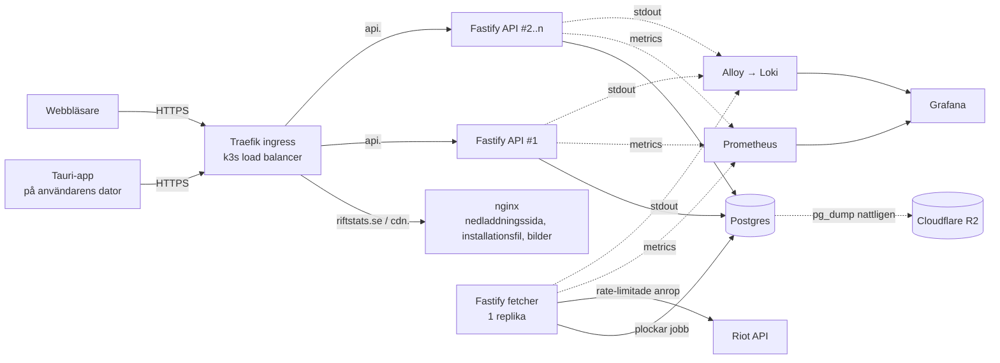

# RiftStats

En lightweight statistikapp för League of Legends, i stil med Mobalytics och Blitz. Sök på ett Riot ID och se rank, matchhistorik och champion-statistik.

Appen är ett **skrivbordsprogram byggt med Tauri** (Rust + React/TypeScript). Den använder operativsystemets inbyggda webview istället för att packa med Chromium som Electron gör, så installationsfilen blir några MB istället för hundratals. Backend är ett Fastify-API som körs på en egen VPS med k3s, CI/CD, tester, backups och monitoring.

Projektet är byggt som examination i en fullstack-kurs.

---

## Adresser

| Tjänst | URL |
|---|---|
| Nedladdningssida | https://riftstats.se |
| API | https://api.riftstats.se |
| CDN (installationsfil och bilder) | https://cdn.riftstats.se |
| Dashboard (Grafana) | https://grafana.riftstats.se |

Inloggning till Grafana delas separat med examinator.

---

## Innehåll

1. [Funktioner](#funktioner)
2. [Arkitektur](#arkitektur)
3. [Tekniska val](#tekniska-val)
4. [Repostruktur](#repostruktur)
5. [API](#api)
6. [Datamodell](#datamodell)
7. [Riot API-integration](#riot-api-integration)
8. [Tester](#tester)
9. [CI/CD](#cicd)
10. [Infrastruktur](#infrastruktur)
11. [Backups](#backups)
12. [Metrics och logging](#metrics-och-logging)
13. [VG: skalning och deploy utan downtime](#vg-skalning-och-deploy-utan-downtime)
14. [Runbook: när något går fel](#runbook-när-något-går-fel)
15. [Lokal utveckling](#lokal-utveckling)
16. [Miljövariabler och secrets](#miljövariabler-och-secrets)

---

## Funktioner

**Måste finnas (MVP)**
- Sök spelare med Riot ID (`Namn#TAG`) och region (EUW, EUNE, NA, KR).
- Profil: ikon, level, rank, LP och winrate för Solo/Duo och Flex.
- Matchhistorik: de senaste 20 matcherna med champion, KDA, CS, items, resultat och speltid.
- Matchdetalj: alla tio spelare i en match.
- Champion-statistik: winrate, KDA och antal matcher per champion, beräknat på cachade matcher.
- "Uppdatera"-knapp som hämtar nya matcher.

**Om tid finns**
- Champion mastery (topp 5).
- Live game via spectator-v5.
- Automatiska uppdateringar av appen via Tauris updater-plugin.
- Mac-version (`.dmg`) i pipelinen.

---

## Arkitektur



### Vägen från request till databas

1. Användaren laddar ner installationsfilen från `cdn.riftstats.se` och installerar appen. Gränssnittet (React, kompilerat från TypeScript till JS) ligger inbakat i appen.
2. Användaren söker på ett Riot ID. Appen anropar `https://api.riftstats.se/v1/...`. Champion-bilder hämtas från `cdn.riftstats.se`.
3. DNS (Cloudflare, DNS only) pekar på VPS:en. Traefik terminerar TLS med ett certifikat från Let's Encrypt via cert-manager och routar på host-header till `api`-servicen.
4. Kubernetes-servicen lastbalanserar till en av API-podarna.
5. Fastify validerar requesten med JSON Schema, läser från Postgres och svarar.
6. Finns spelaren inte i databasen skapar API:t ett jobb i tabellen `fetch_jobs` och svarar `202 Accepted` med ett jobb-ID. Appen pollar `/v1/jobs/:id`.
7. Fetchern plockar jobbet (`SELECT ... FOR UPDATE SKIP LOCKED`), hämtar data från Riot inom rate limiten, skriver till Postgres och markerar jobbet som klart.

Riot-nyckeln finns bara i backend. Appen anropar aldrig Riot direkt, eftersom nyckeln då skulle gå att plocka ut ur installationsfilen.

### Vägen från merge till deploy

1. En pull request mergas till `main`.
2. GitHub Actions kör typecheck och tester.
3. Docker-imagen för API:t byggs, taggas med commit-SHA och pushas till GitHub Container Registry (`ghcr.io/riftstats-1/riftstats-api`).
4. Pipelinen ansluter till servern med SSH, sätter in den nya image-taggen i manifesten och kör `kubectl apply`.
5. Kubernetes gör en rolling update. Nya podar måste klara readiness-proben innan gamla tas bort.
6. Pipelinen väntar på `kubectl rollout status` och kör ett smoke test mot `https://api.riftstats.se/health`. Misslyckas något görs `kubectl rollout undo`.
7. Ett separat jobb bygger Tauri-appen på en Windows-runner och laddar upp installationsfilen till CDN:en. *(planerat)*

---

## Tekniska val

| Val | Varför |
|---|---|
| **Tauri** för klienten | Litet och snabbt jämfört med Electron (några MB istället för 100+), säkert som standard eftersom gränssnittet bara kommer åt de Rust-kommandon som uttryckligen tillåts. Samma React-kod som en webbapp. |
| **React + TypeScript + Vite** | Typat gränssnitt, snabbt bygge. TanStack Query sköter cachning och polling av jobb. |
| **Fastify (TypeScript)** för backend | Snabbt, inbyggd schema-validering, samma språk som klienten så typer kan delas. |
| **Samma image för API och fetcher** | En kodbas och en image. API:t körs i 2–6 replikor, fetchern i exakt en, styrt med en miljövariabel. Ett backend-språk sparar tid jämfört med en separat Rust-worker. |
| **En fetcher-replika** | Riots rate limit gäller per nyckel. Flera fetchers skulle bara konkurrera om samma kvot. |
| **Postgres** | Relationsdata (spelare, matcher, deltagare) plus `jsonb` för rå matchdata. Används även som jobbkö. |
| **Kö i Postgres** | `FOR UPDATE SKIP LOCKED` räcker för vår volym och är en komponent mindre att drifta och backa upp än Redis. |
| **k3s** | Lättviktig Kubernetes för en enda VPS. Ger ingress, load balancing, rolling updates och autoscaling (HPA). |
| **Prometheus + Loki + Grafana** | Standardstack: metrics och loggar i samma dashboard. |
| **Cloudflare R2** för backups | S3-kompatibelt och hos en annan leverantör än servern, så backuperna överlever om VPS:en går förlorad. |

---

## Repostruktur

```
.
├── apps/
│   ├── api/              # Fastify (TypeScript): API och fetcher
│   └── desktop/          # Tauri-app (Rust + React + TypeScript)
├── infra/
│   ├── k8s/              # Kubernetes-manifest (api, postgres, backup)
│   ├── monitoring/       # Helm-värden för Prometheus, Grafana, Loki, Alloy + guide
│   └── scripts/          # restore.sh
├── tests/
│   ├── e2e/              # Playwright
│   └── load/             # k6-skript
├── .github/workflows/    # CI/CD
└── README.md
```

---

## API

Bas-URL: `https://api.riftstats.se`. Alla svar är JSON.

| Metod | Path | Beskrivning |
|---|---|---|
| GET | `/health` | Liveness. Svarar 200 om processen lever. |
| GET | `/ready` | Readiness. Svarar 200 om databasen nås. |
| GET | `/metrics` | Prometheus-metrics (nås bara inifrån klustret). |
| GET | `/v1/players/:region/:gameName/:tagLine` | Profil och rank. `200` om cachad, annars `202` med `jobId`. |
| POST | `/v1/players/:puuid/refresh` | Lägger ett uppdateringsjobb. Max ett per spelare och 2 minuter. |
| GET | `/v1/players/:puuid/matches?limit=20&before=<timestamp>` | Matchhistorik, paginerad. |
| GET | `/v1/players/:puuid/champions` | Aggregerad statistik per champion. |
| GET | `/v1/matches/:matchId` | Alla deltagare i en match. |
| GET | `/v1/jobs/:jobId` | Status: `pending`, `running`, `done`, `failed`. |

**Felformat**

```json
{ "error": { "code": "PLAYER_NOT_FOUND", "message": "Riot ID hittades inte" } }
```

---

## Datamodell

```sql
players (
  puuid          text primary key,
  game_name      text not null,
  tag_line       text not null,
  region         text not null,          -- t.ex. euw1
  profile_icon   int,
  summoner_level int,
  last_fetched   timestamptz
);
create unique index on players (lower(game_name), lower(tag_line), region);

rank_entries (
  puuid       text references players,
  queue_type  text,                      -- RANKED_SOLO_5x5 / RANKED_FLEX_SR
  tier        text, rank text, lp int, wins int, losses int,
  primary key (puuid, queue_type)
);

matches (
  match_id     text primary key,         -- t.ex. EUW1_1234567890
  queue_id     int,
  game_start   timestamptz,
  duration_s   int,
  patch        text,
  raw          jsonb                     -- hela svaret från match-v5
);

match_participants (
  match_id     text references matches,
  puuid        text,
  champion_id  int,
  team_id      int,
  win          boolean,
  kills int, deaths int, assists int,
  cs int, gold int, damage int,
  items        int[],
  primary key (match_id, puuid)
);
create index on match_participants (puuid);

fetch_jobs (
  id          bigserial primary key,
  kind        text,                      -- lookup / refresh
  payload     jsonb,
  status      text default 'pending',
  attempts    int default 0,
  error       text,
  created_at  timestamptz default now(),
  updated_at  timestamptz default now()
);
create index on fetch_jobs (status, created_at);
```

Matcher ändras aldrig efter att de spelats. De hämtas en gång och läses sedan alltid från databasen.

---

## Riot API-integration

All kommunikation med Riot sker i fetchern. API-podarna anropar aldrig Riot direkt.

**Endpoints som används**

| API | Endpoint | Routing |
|---|---|---|
| account-v1 | `/riot/account/v1/accounts/by-riot-id/{gameName}/{tagLine}` | regional (`europe`) |
| summoner-v4 | `/lol/summoner/v4/summoners/by-puuid/{puuid}` | platform (`euw1`) |
| league-v4 | `/lol/league/v4/entries/by-puuid/{puuid}` | platform |
| match-v5 | `/lol/match/v5/matches/by-puuid/{puuid}/ids` | regional |
| match-v5 | `/lol/match/v5/matches/{matchId}` | regional |
| champion-mastery-v4 | `/lol/champion-mastery/v4/champion-masteries/by-puuid/{puuid}/top` | platform (valfri) |

Routing-mappning: `euw1`/`eun1` → `europe`, `na1` → `americas`, `kr` → `asia`.

**Rate limiting**

Personal API key: 20 anrop per sekund och 100 anrop per 2 minuter, per region.

- Fetchern håller båda fönstren med lite marginal (18 / 90).
- Vid `429` läses headern `Retry-After` och fetchern väntar innan nästa anrop.
- Vid `5xx` görs omförsök med exponentiell backoff, max 3 gånger. Därefter markeras jobbet som `failed`.
- Bara match-ID:n som saknas i `matches` hämtas.
- En ny spelare med 20 matcher kostar ungefär 24 anrop.

**Statiska assets**

Champion-, item-, rune- och spell-bilder hämtas från Riots Data Dragon och serveras från `cdn.riftstats.se`. Det belastar inte rate limiten.

---

## Tester

| Nivå | Verktyg | Vad testas |
|---|---|---|
| Unit (API) | Vitest | Endpoints via `app.inject()`, validering, felhantering, stats-beräkningar, routing-mappning. |
| Unit (desktop) | Vitest + Testing Library | Komponenter som matchkort och rank-badge, formatering av KDA och tid. |
| Integration (API) | Vitest + riktig Postgres | Endpoints mot en testdatabas (Postgres som service-container i CI). Fetchern mot en mockad Riot-server, inklusive 429-hantering. |
| E2E | Playwright | Gränssnittet körs i webbläsaren mot API:t med mockad Riot: sök spelare → vänta på jobb → se profil och matchhistorik. |
| Last | k6 | Används för VG-demon av autoscaling. Körs inte i pipelinen. |

Riot API anropas **aldrig** i testerna.

```bash
cd apps/api
npm test
```

---

## CI/CD

GitHub Actions, `.github/workflows/ci-cd.yml`.

| Jobb | Körs | Gör |
|---|---|---|
| Test API | varje pull request och push | `npm ci`, typecheck, tester |
| Build and push image | push till `main` | bygger Docker-imagen och pushar till GHCR med taggarna `<sha>` och `latest` |
| Deploy to k3s | push till `main` | SSH till servern, `kubectl apply` av `api.yaml`, `postgres.yaml` och `backup.yaml`, väntar på rollout, smoke test, rollback vid fel |
| Build desktop | push till `main` *(planerat)* | bygger Tauri-installationsfilen på Windows och laddar upp till CDN:en |

**Secrets i GitHub:** `SSH_HOST`, `SSH_PRIVATE_KEY` (en separat deploy-nyckel utan lösenord), `SSH_KNOWN_HOSTS`. Image-pushen använder den inbyggda `GITHUB_TOKEN`.

Branch protection på `main`: pull request krävs och testerna måste vara gröna.

---

## Infrastruktur

**VPS:** Contabo, 6 vCPU, 12 GB RAM, Ubuntu 24.04, en nod.

**DNS:** Cloudflare (DNS only). A-poster för `riftstats.se`, `api`, `cdn` och `grafana` pekar på VPS:ens IP. Domänen är registrerad hos Loopia.

**Säkerhet:** Inloggning endast med SSH-nyckel, root-inloggning avstängd, en egen användare per gruppmedlem. Brandvägg (ufw): bara 22, 80 och 443 öppna.

**Kluster (k3s)**

| Resurs | Namespace | Detalj |
|---|---|---|
| Ingress | kube-system | Traefik (ingår i k3s) |
| TLS | cert-manager | cert-manager + Let's Encrypt, ClusterIssuer `letsencrypt-prod` |
| `api` | riftstats | Deployment, 2–6 replikor via HPA |
| `fetcher` | riftstats | Deployment, 1 replika, strategy `Recreate` *(planerat)* |
| `web` | riftstats | nginx med nedladdningssida, installationsfil och bilder på `riftstats.se` och `cdn.riftstats.se` *(planerat)* |
| `postgres` | riftstats | StatefulSet, Postgres 17, 10 GB disk (local-path) |
| `pg-backup` | riftstats | CronJob, nattlig dump till R2 |
| Monitoring | monitoring | kube-prometheus-stack, Loki och Alloy via Helm |

**En nod, en avvägning:** Flera podar skyddar mot att en process kraschar och gör deploy utan downtime möjlig, men inte mot att servern går ner. Skyddet mot det är backuperna i R2, hos en annan leverantör, och att klustret kan sättas upp igen från manifesten i repot.

---

## Backups

- **När:** varje natt kl. 03:00 svensk tid, CronJob `pg-backup`.
- **Hur:** `pg_dump -Fc` (komprimerat) i en initContainer, sedan laddar aws-cli upp filen till Cloudflare R2 som `postgres/YYYY/MM/DD-HHMM.dump` (UTC).
- **Retention:** 14 dagar via en lifecycle-regel i bucketen `riftstats-backups`.
- **Övervakning:** Grafana visar när senaste backupen lyckades (`kube_cronjob_status_last_successful_time`).

**Kör en backup direkt**

```bash
kubectl create job --from=cronjob/pg-backup pg-backup-manual -n riftstats
kubectl logs -n riftstats -l job-name=pg-backup-manual -c upload -f
```

**Restore**

```bash
./infra/scripts/restore.sh                                  # listar backuperna i R2
./infra/scripts/restore.sh postgres/2026/11/03-0200.dump    # återställer en backup
```

Scriptet skalar ner API:t, hämtar dumpen från R2, kör `pg_restore --clean` och skalar upp API:t igen.

---

## Metrics och logging

**Grafana:** https://grafana.riftstats.se. Installation och felsökning beskrivs i [`infra/monitoring/README.md`](infra/monitoring/README.md).

**Metrics (Prometheus)**
- Kluster och server: CPU och minne per pod och nod, antal podar per deployment, HPA-status, omstarter (node-exporter och kube-state-metrics).
- Backup: tid sedan senaste lyckade körning.
- API: requests per sekund, latens och felfrekvens per route via `/metrics`. *(planerat)*

**Loggar (Loki)**
- Alloy läser stdout från alla podar och skickar till Loki, med etiketterna `namespace`, `pod`, `container` och `app`.
- API:t loggar JSON via Fastifys inbyggda logger (pino).

**Dashboard "RiftStats overview"** (`infra/monitoring/dashboards/overview.json`)
1. Antal API-podar (visar autoscaling)
2. CPU och minne per pod
3. Request rate, felfrekvens och latens
4. Pod-omstarter
5. Senaste backup
6. Loggpanel för API:t

---

## VG: skalning och deploy utan downtime

**Minst två instanser bakom load balancer**
`api` har minst 2 replikor. Traefik och Kubernetes-servicen fördelar trafiken mellan dem.

**Deploy utan downtime**
- `strategy: RollingUpdate`, `maxUnavailable: 0`, `maxSurge: 1`.
- Readiness probe på `/ready`. En pod får trafik först när den är redo.
- Fastify stänger ner graciöst vid SIGTERM: slutar ta emot nya anslutningar och avslutar pågående requests.
- `preStop: sleep 5` så att podden hinner tas bort från load balancern innan den stängs.
- PodDisruptionBudget med `minAvailable: 1`.

**Autoscaling**
- HPA: min 2, max 6 replikor, mål 50 % CPU.
- Låg CPU-request (`100m`) så att skalningen syns vid rimlig last.

**Demo**

```bash
# Terminal 1: kontinuerlig last
k6 run tests/load/spike.js

# Terminal 2: se skalningen
kubectl get hpa api -n riftstats -w

# Under lasten: merga en ändring och visa att k6 inte rapporterar några misslyckade requests
```

I Grafana syns antalet podar öka under last och minska efter några minuter. Felfrekvensen ligger kvar på 0 under deployen.

---

## Runbook: när något går fel

| Symptom | Första steg |
|---|---|
| API svarar inte | `kubectl get pods -n riftstats`, `kubectl logs -n riftstats deploy/api`, kolla Grafana. Ingress: `kubectl get ingress -n riftstats`. |
| Ny version är trasig | Pipelinen rullar tillbaka automatiskt. Manuellt: `kubectl -n riftstats rollout undo deployment/api`. Revertera committen och merga. |
| Podar i `ImagePullBackOff` | Kontrollera att paketet `riftstats-api` i GHCR är publikt och att taggen finns. |
| Deploy fastnar med "exceeded its progress deadline" | `kubectl -n riftstats rollout restart deployment/api` när orsaken är åtgärdad. |
| Många 429 från Riot | Fetchern backar av automatiskt. Kolla kölängden. Sänk takten via miljövariabler vid behov. |
| Riot-nyckeln fungerar inte | Byt secret: `kubectl create secret generic riot-api-key -n riftstats --from-literal=key=... --dry-run=client -o yaml \| kubectl apply -f -`, starta om fetchern. |
| Databasen är nere | `kubectl describe pod postgres-0 -n riftstats`, kolla disk med `df -h`. API:ts readiness faller och podarna tas ur rotation. |
| Data förstörd | Återställ från backup med `restore.sh`. |
| Backupen har inte körts | `kubectl get cronjob,jobs -n riftstats`, `kubectl logs -n riftstats job/<namn> -c upload`. Kontrollera secreten `r2-credentials`. |
| Certifikat har gått ut | `kubectl get certificate -A`, `kubectl describe certificate <namn> -n <namespace>`, kolla cert-manager-loggar. |
| Disken full | `df -h`, rensa gamla images med `sudo k3s crictl rmi --prune`, kolla retention i Prometheus och Loki. |
| Servern borta | Ny VPS, installera k3s och cert-manager, skapa secrets, kör pipelinen, återställ databasen från R2 med `restore.sh`. |

---

## Lokal utveckling

Krav: Node 22, Git. För desktop-appen även Rust (rustup) och Microsoft C++ Build Tools.

**API**

```bash
cd apps/api
npm install
npm test
npm run dev              # http://localhost:3000
```

**Desktop-app**

```bash
cd apps/desktop
npm install
npm run tauri dev        # öppnar appen med hot reload
npm run tauri build      # bygger installationsfilen
```

---

## Miljövariabler och secrets

**Miljövariabler**

| Variabel | Tjänst | Beskrivning |
|---|---|---|
| `PORT` | api | Standard 3000 |
| `LOG_LEVEL` | api | `info` i produktion |
| `DATABASE_URL` | api, fetcher | Postgres-anslutning *(planerat)* |
| `MODE` | api, fetcher | `api` eller `fetcher`, styr vilken roll processen har *(planerat)* |
| `RIOT_RATE_PER_SEC` / `RIOT_RATE_PER_2MIN` | fetcher | Rate limit, standard 18 / 90 *(planerat)* |
| `VITE_API_URL` | desktop (build) | `https://api.riftstats.se` |

**Kubernetes-secrets** (skapas manuellt på servern, checkas aldrig in)

| Secret | Namespace | Innehåll |
|---|---|---|
| `postgres-credentials` | riftstats | `password` |
| `r2-credentials` | riftstats | `AWS_ACCESS_KEY_ID`, `AWS_SECRET_ACCESS_KEY`, `S3_ENDPOINT`, `S3_BUCKET` |
| `riot-api-key` | riftstats | `key` *(planerat)* |
| `grafana-admin` | monitoring | `admin-user`, `admin-password` |

---

## Grupp

| Namn | Huvudansvar |
|---|---|
| … | Infrastruktur, CI/CD, backups |
| Mehdi | Monitoring |
| … | API och Riot-integration |

Alla i gruppen ska kunna förklara hela lösningen.

---

*RiftStats är inte kopplat till eller godkänt av Riot Games.*
