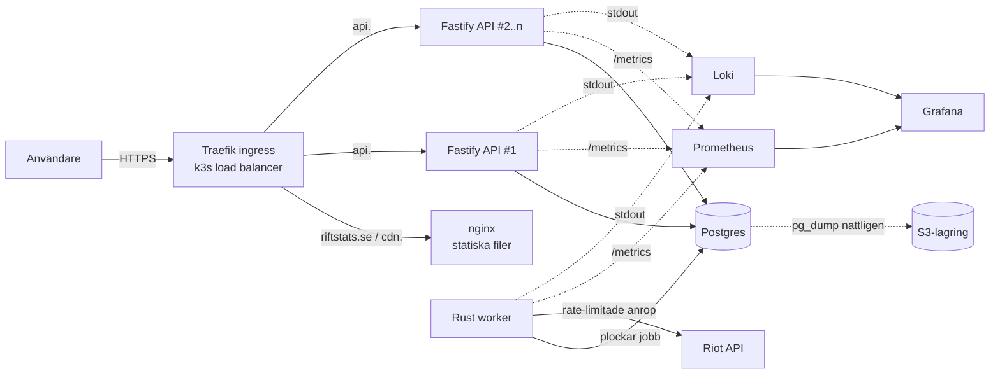

# RiftStats

En lightweight statistikapp för League of Legends, i stil med Mobalytics och Blitz. Sök på ett Riot ID och se rank, matchhistorik, champion-statistik och mastery.

Projektet är byggt som examination i en fullstack-kurs och körs på en egen VPS med k3s, CI/CD, tester, backups och monitoring.

> **Arkitekturbeslut:** Fastify (TypeScript) är det publika API:t. En Rust-worker sköter all kommunikation med Riot API. Motiveringen finns i [Tekniska val](#tekniska-val).

---

## Adresser

| Tjänst | URL |
|---|---|
| Webbapp | https://riftstats.se |
| API | https://api.riftstats.se |
| CDN (statiska filer) | https://cdn.riftstats.se |
| Dashboard (Grafana) | https://grafana.riftstats.se |

Inloggning till Grafana delas separat med examinator.

---

## Innehåll

1. [Funktioner](#funktioner)
2. [Arkitektur](#arkitektur)
3. [Tekniska val](#tekniska-val)
4. [Repostruktur](#repostruktur)
5. [API](#api)
6. [Datamodell](#datamodell)
7. [Riot API-integration](#riot-api-integration)
8. [Tester](#tester)
9. [CI/CD](#cicd)
10. [Infrastruktur](#infrastruktur)
11. [Backups](#backups)
12. [Metrics och logging](#metrics-och-logging)
13. [VG: skalning och deploy utan downtime](#vg-skalning-och-deploy-utan-downtime)
14. [Runbook: när något går fel](#runbook-när-något-går-fel)
15. [Lokal utveckling](#lokal-utveckling)
16. [Miljövariabler](#miljövariabler)

---

## Funktioner

**Måste finnas (MVP)**
- Sök spelare med Riot ID (`Namn#TAG`) och region (EUW, EUNE, NA, KR).
- Profil: ikon, level, rank, LP och winrate för Solo/Duo och Flex.
- Matchhistorik: de senaste 20 matcherna med champion, KDA, CS, items, resultat och speltid.
- Matchdetalj: alla tio spelare i en match.
- Champion-statistik: winrate, KDA och antal matcher per champion, beräknat på cachade matcher.
- "Uppdatera"-knapp som hämtar nya matcher.

**Om tid finns**
- Champion mastery (topp 5).
- Live game via spectator-v5.
- Guldkurva från match-timeline.

---

## Arkitektur



### Vägen från request till databas

1. Webbläsaren laddar `index.html` från `riftstats.se`. JS, CSS och bilder hämtas från `cdn.riftstats.se`.
2. React-appen anropar `https://api.riftstats.se/v1/...`.
3. DNS pekar på VPS:en. Traefik terminerar TLS (certifikat från Let's Encrypt via cert-manager) och routar på host-header till `api`-servicen.
4. Kubernetes-servicen lastbalanserar till en av Fastify-podarna.
5. Fastify validerar requesten med JSON Schema, läser från Postgres och svarar.
6. Finns spelaren inte i databasen skapar Fastify ett jobb i tabellen `fetch_jobs` och svarar `202 Accepted` med ett jobb-ID. Frontend pollar `/v1/jobs/:id`.
7. Rust-workern plockar jobbet (`SELECT ... FOR UPDATE SKIP LOCKED`), hämtar data från Riot inom rate limiten, skriver till Postgres och markerar jobbet som klart.

### Vägen från merge till deploy

1. En pull request mergas till `main`.
2. GitHub Actions kör lint, unit-, integrations- och e2e-tester.
3. Docker-images för `api`, `worker` och `web` byggs och taggas med commit-SHA, och pushas till GitHub Container Registry.
4. Pipelinen uppdaterar deployments i k3s med den nya image-taggen.
5. Kubernetes gör en rolling update. Nya podar måste klara readiness-proben innan gamla tas bort.
6. Pipelinen väntar på `kubectl rollout status` och kör ett smoke test mot `https://api.riftstats.se/health`. Misslyckas det görs `kubectl rollout undo`.

---

## Tekniska val

| Val | Varför |
|---|---|
| **Fastify (TypeScript)** för API:t | Snabbt, inbyggd schema-validering, samma språk som frontend så typer kan delas via `packages/types`. |
| **Rust (tokio, reqwest, sqlx)** för workern | Långlivad process med mycket JSON-parsning och strikt rate limiting. Låg minnesanvändning, och kompilatorn fångar fel i Riot-datamodellerna. |
| **Postgres** | Relationsdata (spelare, matcher, deltagare) plus `jsonb` för rå matchdata. Används även som jobbkö, så vi slipper Redis. |
| **Kö i Postgres** | `FOR UPDATE SKIP LOCKED` räcker för vår volym och är en komponent mindre att drifta och backa upp. |
| **En worker-replika** | Riots rate limit gäller per nyckel. Flera workers skulle bara konkurrera om samma kvot. |
| **React + TypeScript + Vite** | Statiskt bygge som kan serveras från CDN. TanStack Query sköter cachning och polling. |
| **k3s** | Lättviktig Kubernetes för en enda VPS. Ger ingress, load balancing, rolling updates och HPA. |
| **Prometheus + Loki + Grafana** | Standardstack, en dashboard för både metrics och loggar. |

---

## Repostruktur

```
.
├── apps/
│   ├── web/              # React + TypeScript + Vite
│   ├── api/              # Fastify (TypeScript)
│   └── worker/           # Rust-worker (Cargo-projekt)
├── packages/
│   └── types/            # Delade TypeScript-typer och JSON Schemas
├── db/
│   └── migrations/       # SQL-migrationer (körs av sqlx migrate)
├── infra/
│   ├── k8s/              # Kubernetes-manifest (deployments, services, ingress, HPA, CronJob)
│   ├── monitoring/       # Grafana-dashboards (JSON) och Helm-values
│   └── scripts/          # Bootstrap av VPS, restore-script
├── tests/
│   ├── e2e/              # Playwright
│   ├── load/             # k6-skript
│   └── riot-mock/        # Mock-server för Riot API med fixtures
├── .github/workflows/    # CI/CD
├── docker-compose.yml    # Lokal utveckling
└── README.md
```

---

## API

Bas-URL: `https://api.riftstats.se`. Alla svar är JSON.

| Metod | Path | Beskrivning |
|---|---|---|
| GET | `/health` | Liveness. Svarar 200 om processen lever. |
| GET | `/ready` | Readiness. Svarar 200 om databasen nås. |
| GET | `/metrics` | Prometheus-metrics (nås bara inifrån klustret). |
| GET | `/v1/players/:region/:gameName/:tagLine` | Profil och rank. `200` om cachad, annars `202` med `jobId`. |
| POST | `/v1/players/:puuid/refresh` | Lägger ett uppdateringsjobb. Max ett per spelare och 2 minuter. |
| GET | `/v1/players/:puuid/matches?limit=20&before=<timestamp>` | Matchhistorik, paginerad. |
| GET | `/v1/players/:puuid/champions` | Aggregerad statistik per champion. |
| GET | `/v1/matches/:matchId` | Alla deltagare i en match. |
| GET | `/v1/jobs/:jobId` | Status: `pending`, `running`, `done`, `failed`. |

**Felformat**

```json
{ "error": { "code": "PLAYER_NOT_FOUND", "message": "Riot ID hittades inte" } }
```

---

## Datamodell

```sql
players (
  puuid          text primary key,
  game_name      text not null,
  tag_line       text not null,
  region         text not null,          -- t.ex. euw1
  profile_icon   int,
  summoner_level int,
  last_fetched   timestamptz
);
create unique index on players (lower(game_name), lower(tag_line), region);

rank_entries (
  puuid       text references players,
  queue_type  text,                      -- RANKED_SOLO_5x5 / RANKED_FLEX_SR
  tier        text, rank text, lp int, wins int, losses int,
  primary key (puuid, queue_type)
);

matches (
  match_id     text primary key,         -- t.ex. EUW1_1234567890
  queue_id     int,
  game_start   timestamptz,
  duration_s   int,
  patch        text,
  raw          jsonb                     -- hela svaret från match-v5
);

match_participants (
  match_id     text references matches,
  puuid        text,
  champion_id  int,
  team_id      int,
  win          boolean,
  kills int, deaths int, assists int,
  cs int, gold int, damage int,
  items        int[],
  primary key (match_id, puuid)
);
create index on match_participants (puuid);

fetch_jobs (
  id          bigserial primary key,
  kind        text,                      -- lookup / refresh
  payload     jsonb,
  status      text default 'pending',
  attempts    int default 0,
  error       text,
  created_at  timestamptz default now(),
  updated_at  timestamptz default now()
);
create index on fetch_jobs (status, created_at);
```

Matcher ändras aldrig efter att de spelats. De hämtas en gång och läses sedan alltid från databasen.

---

## Riot API-integration

All kommunikation med Riot sker i `apps/worker`. API:t anropar aldrig Riot direkt.

**Endpoints som används**

| API | Endpoint | Routing |
|---|---|---|
| account-v1 | `/riot/account/v1/accounts/by-riot-id/{gameName}/{tagLine}` | regional (`europe`) |
| summoner-v4 | `/lol/summoner/v4/summoners/by-puuid/{puuid}` | platform (`euw1`) |
| league-v4 | `/lol/league/v4/entries/by-puuid/{puuid}` | platform |
| match-v5 | `/lol/match/v5/matches/by-puuid/{puuid}/ids` | regional |
| match-v5 | `/lol/match/v5/matches/{matchId}` | regional |
| champion-mastery-v4 | `/lol/champion-mastery/v4/champion-masteries/by-puuid/{puuid}/top` | platform (valfri) |

Routing-mappning: `euw1`/`eun1` → `europe`, `na1` → `americas`, `kr` → `asia`.

**Rate limiting**

Personal API key: 20 anrop per sekund och 100 anrop per 2 minuter, per region.

- Workern använder en token bucket (`governor`) med båda fönstren, med lite marginal.
- Vid `429` läses headern `Retry-After` och workern väntar innan nästa anrop.
- Vid `5xx` görs omförsök med exponentiell backoff, max 3 gånger. Därefter markeras jobbet som `failed`.
- Bara match-ID:n som saknas i `matches` hämtas.
- En ny spelare med 20 matcher kostar ungefär 24 anrop.

**API-nyckel**

Nyckeln ligger som Kubernetes-secret (`riot-api-key`) och som GitHub-secret. Den checkas aldrig in och loggas aldrig.

**Statiska assets**

Champion-, item-, rune- och spell-bilder hämtas från Data Dragon i ett steg i pipelinen och serveras från `cdn.riftstats.se`. Det belastar inte rate limiten.

---

## Tester

| Nivå | Verktyg | Vad testas |
|---|---|---|
| Unit (Rust) | `cargo test` | Parsning av Riot-svar mot sparade fixtures, rate limiter, routing-mappning, beräkning av stats. |
| Unit (API) | Vitest | Validering, felhantering, aggregering av champion-stats. |
| Unit (web) | Vitest + Testing Library | Komponenter som matchkort och rank-badge, formatering av KDA och tid. |
| Integration (API) | Vitest + riktig Postgres | Endpoints mot en testdatabas med seed-data (Postgres som service-container i CI). |
| Integration (worker) | `#[sqlx::test]` + `wiremock` | Hela flödet jobb → Riot-mock → databas, inklusive 429-hantering. |
| E2E | Playwright | Sök spelare → vänta på jobb → se profil och matchhistorik → öppna match. Hela stacken körs med docker compose mot `riot-mock`. |
| Last | k6 | Används för VG-demon av autoscaling. Körs inte i pipelinen. |

Riot API anropas **aldrig** i testerna. Fixtures ligger i `tests/riot-mock/fixtures/`.

```bash
# Allt lokalt
docker compose up -d postgres riot-mock
pnpm test                      # unit och integration för api och web
cargo test --manifest-path apps/worker/Cargo.toml
pnpm e2e                       # Playwright
```

---

## CI/CD

GitHub Actions, `.github/workflows/`.

**`ci.yml` körs på varje pull request**
1. Lint och typecheck (`eslint`, `tsc`, `cargo clippy`, `cargo fmt --check`).
2. Unit- och integrationstester (Postgres som service).
3. Bygg alla images för att verifiera att bygget fungerar.
4. E2E med docker compose.

**`deploy.yml` körs på push till `main`**
1. Samma tester som ovan. Ingen deploy om något fallerar.
2. Bygg och pusha images till `ghcr.io/riftstats-1/riftstats-{api,worker,web}:<sha>`.
3. Kör databasmigrationer som ett Kubernetes-Job.
4. `kubectl set image` för `api`, `worker` och `web`.
5. `kubectl rollout status` med timeout.
6. Smoke test mot `https://api.riftstats.se/health`. Vid fel: `kubectl rollout undo`.

**Secrets i GitHub:** `KUBECONFIG` (base64), `RIOT_API_KEY`, `GHCR_TOKEN`.

Branch protection på `main`: PR krävs och CI måste vara grön.

---

## Infrastruktur

**VPS:** minst 4 vCPU och 8 GB RAM rekommenderas (k3s, Postgres, Prometheus, Loki och Grafana kräver tillsammans runt 4 GB).

**DNS:** A-poster för `riftstats.se`, `api`, `cdn` och `grafana` pekar på VPS:ens IP.

**Kluster (k3s)**

| Resurs | Detalj |
|---|---|
| Ingress | Traefik (ingår i k3s) |
| TLS | cert-manager + Let's Encrypt, ClusterIssuer `letsencrypt-prod` |
| `api` | Deployment, 2–6 replikor, HPA |
| `worker` | Deployment, 1 replika, strategy `Recreate` |
| `web` | nginx som serverar Vite-bygget och Data Dragon-assets på `riftstats.se` och `cdn.riftstats.se`. Vite byggs med `base: "https://cdn.riftstats.se/"`. |
| `postgres` | StatefulSet med PersistentVolume (local-path) |
| `pg-backup` | CronJob, nattlig dump till S3 |
| Monitoring | `kube-prometheus-stack` och `loki-stack` via Helm |

Brandvägg (ufw): bara 22, 80 och 443 öppna. SSH endast med nyckel.

Bootstrap av en ny server beskrivs i `infra/scripts/bootstrap.sh`.

---

## Backups

- **När:** varje natt kl. 03:00, CronJob `pg-backup`.
- **Hur:** `pg_dump -Fc` → gzip → upload till S3-kompatibel lagring (`s3://riftstats-backups/YYYY/MM/DD.dump.gz`).
- **Retention:** 14 dagar via lifecycle-regel i bucketen.
- **Övervakning:** jobbet pushar `backup_last_success_timestamp` till Prometheus. Grafana visar senaste lyckade backup och larmar om den är äldre än 26 timmar.

**Restore**

```bash
./infra/scripts/restore.sh 2026/11/03.dump.gz
# Laddar ner dumpen, skalar ner api och worker,
# kör pg_restore --clean och skalar upp igen.
```

Restore har testats mot en separat databas. Testa igen inför försvaret.

---

## Metrics och logging

**Grafana:** https://grafana.riftstats.se

**Metrics (Prometheus)**
- API: requests per sekund, p50/p95/p99-latens, felfrekvens per route (`fastify-metrics`).
- Worker: Riot-anrop per endpoint, antal `429`, kölängd, jobbtid (`prometheus`-craten).
- Kluster: antal podar per deployment, CPU och minne, HPA-status.
- Backup: tid sedan senaste lyckade backup.

**Loggar (Loki)**
- API loggar JSON via pino. Worker loggar JSON via `tracing-subscriber`.
- Varje request får ett `requestId` som följer med till jobbet i workern, så en sökning kan spåras från request till Riot-anrop.

**Dashboard "RiftStats overview"** (`infra/monitoring/dashboards/overview.json`)
1. Request rate och felfrekvens
2. Latens p95
3. Antal API-podar (visar autoscaling)
4. CPU per pod
5. Riot-anrop och 429:or
6. Kölängd
7. Senaste backup
8. Loggpanel med filter på nivå och tjänst

---

## VG: skalning och deploy utan downtime

**Minst två instanser bakom load balancer**
`api` har minst 2 replikor. Traefik och Kubernetes-servicen fördelar trafiken.

**Deploy utan downtime**
- `strategy: RollingUpdate`, `maxUnavailable: 0`, `maxSurge: 1`.
- Readiness probe på `/ready`. En pod får trafik först när den nått databasen.
- Fastify stänger ner graciöst vid SIGTERM: slutar ta emot nya anslutningar och avslutar pågående requests.
- `preStop: sleep 5` så att podden hinner tas bort från load balancern innan den stängs.
- PodDisruptionBudget med `minAvailable: 1`.

**Autoscaling**
- HPA: min 2, max 6 replikor, mål 50 % CPU.
- Låg CPU-request (`100m`) så att skalningen syns vid rimlig last.

**Demo**

```bash
# Terminal 1: kontinuerlig last
k6 run tests/load/spike.js

# Terminal 2: se skalningen
kubectl get hpa api -w

# Under lasten: merga en ändring och visa att k6 inte rapporterar några misslyckade requests
```

I Grafana syns antalet podar öka under last och minska efter några minuter. Error rate ligger kvar på 0 under deployen.

---

## Runbook: när något går fel

| Symptom | Första steg |
|---|---|
| API svarar inte | `kubectl get pods`, `kubectl logs deploy/api`, kolla Grafana. Ingress? `kubectl get ingress`. |
| Ny version är trasig | `kubectl rollout undo deployment/api`. Revertera committen och merga. |
| Många 429 från Riot | Kolla kölängd och 429-panelen. Workern backar av automatiskt. Sänk takten i konfigurationen vid behov. |
| Riot-nyckeln fungerar inte | Byt secret: `kubectl create secret generic riot-api-key --from-literal=key=... --dry-run=client -o yaml \| kubectl apply -f -`, starta om workern. |
| Databasen är nere | `kubectl describe pod postgres-0`, kolla diskutrymme. API:ts readiness faller och podarna tas ur rotation. |
| Data förstörd | Återställ från backup med `restore.sh`. |
| Certifikat har gått ut | `kubectl describe certificate`, kolla cert-manager-loggar. |
| Disken full | `df -h`, rensa gamla images (`k3s crictl rmi --prune`), kolla Loki-retention. |

---

## Lokal utveckling

Krav: Node 22, pnpm, Rust (stable), Docker.

```bash
cp .env.example .env               # fyll i RIOT_API_KEY
docker compose up -d postgres
pnpm install
pnpm --filter api migrate
pnpm --filter api dev              # http://localhost:3000
cargo run --manifest-path apps/worker/Cargo.toml
pnpm --filter web dev              # http://localhost:5173
```

Utan en riktig nyckel: starta `riot-mock` och sätt `RIOT_BASE_URL=http://localhost:4010`.

---

## Miljövariabler

| Variabel | Tjänst | Beskrivning |
|---|---|---|
| `DATABASE_URL` | api, worker | Postgres-anslutning |
| `RIOT_API_KEY` | worker | Riot-nyckel (secret) |
| `RIOT_BASE_URL` | worker | Överskriv för mock i test |
| `RIOT_RATE_PER_SEC` / `RIOT_RATE_PER_2MIN` | worker | Rate limit, standard 18 / 90 |
| `PORT` | api | Standard 3000 |
| `LOG_LEVEL` | api, worker | `info` i produktion |
| `CORS_ORIGIN` | api | `https://riftstats.se` |
| `VITE_API_URL` | web (build) | `https://api.riftstats.se` |
| `S3_BUCKET`, `S3_ENDPOINT`, `AWS_ACCESS_KEY_ID`, `AWS_SECRET_ACCESS_KEY` | pg-backup | Backup-lagring |

---

## Grupp

| Namn | Huvudansvar |
|---|---|
| … | … |
| … | … |

Alla i gruppen ska kunna förklara hela lösningen.

---

*RiftStats är inte kopplat till eller godkänt av Riot Games.*
